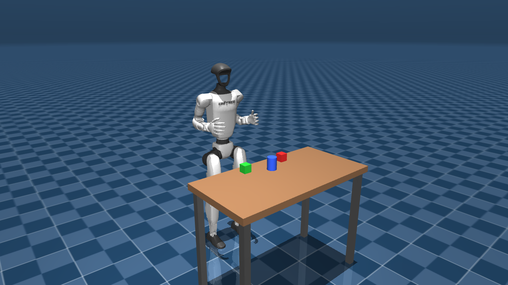
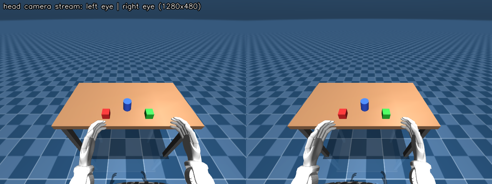
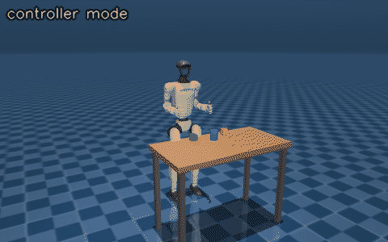

# Stage 1: Teleoperate the simulated G1 with a Quest 3



**What you will have at the end of this stage**

- A MuJoCo G1 that answers on the same DDS topics and camera protocol as the real robot.
- Unitree's unmodified xr_teleoperate driving it from a Meta Quest 3, with hand tracking or with the controllers.
- Walking (left stick) and waist twist (right stick) in controller mode.

**Prerequisites**

- Ubuntu 22.04 or 24.04 PC. Any GPU.
- Meta Quest 3 on the **same Wi-Fi** as the PC.
- New words (DDS, domain id, teleimager, IK, MJCF): see the [glossary](../docs/GLOSSARY.md).

## 1. Install (once, about 10 minutes)

On a fresh Ubuntu, install the basic tools first (once):

```bash
sudo apt install -y git curl openssl
```

Then clone and install:

```bash
git clone -b mobilab https://github.com/MOBILAB-UDESC/unitree_lerobot.git
cd unitree_lerobot/g1_mujoco_real2sim
install/install.sh
```

What it does:

- Installs conda (Miniforge) if the PC has none.
- Creates the conda env `g1sim` (Python 3.10, MuJoCo, pinocchio).
- Clones `xr_teleoperate`, `unitree_mujoco`, `unitree_sdk2_python` and `unitree_lerobot` into `third_party/` at the tested commits. Nothing in them is edited.
- Creates a self-signed HTTPS certificate in `~/.config/xr_teleoperate/` (the Quest browser only allows VR on HTTPS pages).

You should see `imports OK`, `lab scene OK: [...]` and `Install finished.`

Open the firewall ports the Quest uses. If the firewall is off this does no harm:

```bash
sudo ufw allow 8012 && sudo ufw allow 8080
```

All commands below are run from the repository folder. The `scripts/run_*.sh` scripts activate the conda env themselves.

## 2. Start the simulator (terminal 1)

```bash
scripts/run_sim.sh
```

You should see a MuJoCo window with the G1 in front of a table with two cubes and a cylinder, and:

```
[sim] DDS domain 1 on 'lo' | lowstate @500Hz | objects: ['red_cube', 'green_cube', 'blue_cylinder']
[sim] image server: config tcp://*:60000 | head_camera 1280x480 :55555 @ 30 fps
[sim] base mode: FIXED pelvis | viewer keys: 9 = toggle fixed/free, 0 = reset
```

## 3. Check it without the headset (optional)

With the simulator running, in a second terminal:

```bash
source scripts/env.sh g1sim
python 01_teleop/g1sim/test_dds_smoke.py
```

You should see the robot's left elbow swing for 4 seconds, then:

```
rt/lowstate rate: 500 Hz (mode_machine=5)
left elbow max tracking error after settling: 0.0xx rad
PASS
```

## 4. Start teleop (terminal 2)

Pick one mode.

| Mode | Command | What moves | Like on the real robot |
|---|---|---|---|
| Controller | `scripts/run_teleop.sh --controller` | Arms follow the controllers. Left stick walks. Right stick twists the waist. | Motion mode (`--input-mode controller --motion`) |
| Hand tracking | `scripts/run_teleop.sh` | Arms follow your bare hands. No walking. | Debug mode (xr_teleoperate commands every joint) |

```bash
scripts/run_teleop.sh --controller
```

You should see, first:

```
On the Quest 3 browser open:  http://192.168.x.x:8080
```

and, after some seconds:

```
Press [r] to start syncing the robot with your movements.
```

- The address is the PC's IP. `:8080` is a short link that redirects to the full `https://<pc-ip>:8012/?ws=wss://<pc-ip>:8012`.
- Any other flag goes to Unitree's `teleop_hand_and_arm.py`, for example `--record` (see [stage 4](../04_recording/README.md)).
- `scripts/run_teleop.sh --plain` runs Unitree's script with nothing added. Without `--plain`, a small launcher adds the wrist camera views of [stage 2](../02_wrist_cameras/README.md); in this stage there are no wrist cameras, so it behaves exactly like the plain one.

## 5. Connect the Quest 3

1. Put on the headset and open the **Browser**.
2. Type the short link that terminal 2 printed in step 4. It looks like `192.168.x.x:8080`, with the PC's real address.
3. A certificate warning appears. Tap **Advanced**, then **Proceed to ... (unsafe)**. This is expected: the certificate is self-signed.
4. Tap **Virtual Reality** and allow the permissions.

You should now see what the robot's head cameras see, in 3D.



## 6. Start moving

1. Hold your arms or controllers roughly like the robot's arms.
2. On the PC, click terminal 2 and press **r**. The robot now follows you.

You should see `[sim] driven by rt/arm_sdk + joysticks (xr_teleoperate --motion)` in terminal 1 (controller mode), or `[sim] driven by rt/lowcmd (xr_teleoperate debug mode)` (hand tracking).



| Control | What it does |
|---|---|
| Controllers / hands | The robot's wrists follow yours |
| **Left stick** (controller mode) | Walk forward/back and sideways, in the direction the torso faces (max 0.3 m/s) |
| **Right stick** left/right (controller mode) | Twist the waist to look around, feet still. Past about 86 degrees the whole body turns. |
| **A** (right controller) | Stop teleop |
| **r** in terminal 2 | Start following |
| **q** in terminal 2 | Stop teleop. The arms go home first. |
| **s** in terminal 2 | Start / save an episode, only when started with `--record` |

**Warning: do not click both thumbsticks in at the same time.** On the real robot that is the soft emergency stop (Damp: the motors go limp). With the xr_teleoperate commit pinned here, that code path calls a function that does not exist, so teleop crashes.

Walking only works in **FIXED** mode (see step 8). It is kinematic: an invisible "gantry" carries the pelvis and the legs play a stepping animation.

## 7. Leave VR and stop

- **Leave VR with controllers:** press the **Meta button** on the right controller, then exit the immersive view.
- **Leave VR with hand tracking:** turn your palm toward your face, pinch thumb and index finger and hold.
- Teleop keeps running on the PC. Tap **Virtual Reality** again to go back in.
- **Stop:** press **q** in terminal 2, then **Ctrl+C** in terminal 1.

## 8. Simulator keys and options

Click the MuJoCo window first.

| Key | What it does |
|---|---|
| **9** | Toggle **FIXED** pelvis (robot hangs on a gantry, can walk) and **FREE-standing** (feet on the floor, cannot walk, can fall) |
| **0** | Reset the robot and the objects |
| Double-click + Ctrl-drag | Push things (normal MuJoCo mouse perturbation) |

Options for `scripts/run_sim.sh` (full list: `scripts/run_sim.sh --help`):

| Option | Default | What it does |
|---|---|---|
| `--scene` | `demo` | `demo`, `lab` (stage 3) or a path to your own environment MJCF |
| `--addon NAME` | none | Load an add-on, e.g. `wrist_cameras` (stage 2). Repeatable. |
| `--free` | off | Start free-standing |
| `--no-viewer` | off | No desktop window. Leaves more GPU for the headset stream. |
| `--walk-scale`, `--turn-scale` | 1.0, 2.0 | Multipliers on joystick walking speed and turning rate |
| `--cam-pitch`, `--cam-pos`, `--baseline`, `--fovy` | 40 deg, head mount, 0.064 m, 90 deg | Head stereo camera of the demo scene |
| `--img-w`, `--img-h`, `--fps` | 640, 480, 30 | Image size of one eye and frame rate |
| `--domain`, `--iface` | 1, `lo` | DDS domain id and network interface |
| `--port-offset N` | 0 | Add N to every image port, to run a second sim next to the first (use a different `--domain` too) |
| `--debug-video FILE.mp4` | off | Save a 15 fps overview video |
| `--log-qpos FILE.npz` | off | Save the simulation state at 30 Hz when the sim exits, to re-render a session later |
| `--camera-shadows all\|head\|none` | head | Which camera streams render shadows. `none` saves about 5 ms per frame on an integrated GPU |

To change the scene, edit [g1sim/scenes/scene_demo.xml](g1sim/scenes/scene_demo.xml). Every body with a `<freejoint/>` is an object: key 0 resets it and its pose is published on `rt/sim_state`.

## 9. How it works

- [g1sim/g1_xr_sim.py](g1sim/g1_xr_sim.py) loads Unitree's `g1_29dof.xml`, attaches the scene, and steps MuJoCo in real time.
- Physics and the PD control loop run on their own thread at real time. Camera rendering (tens of milliseconds per frame on an integrated GPU) runs on the main thread and cannot hold the control loop back. If the PC still cannot keep up, the sim prints `[sim] WARNING: PC overloaded ...`.
- It subscribes to `rt/lowcmd` (debug mode: a PD torque per joint) and to `rt/arm_sdk` plus the locomotion request topic (motion mode: it plays Unitree's motion controller), and publishes `rt/lowstate` at 500 Hz.
- It renders the head cameras and serves them with teleimager's own ZMQ classes: a config reply on port 60000 and a JPEG stream on port 55555.
- xr_teleoperate is started with `--sim --network-interface lo --img-server-ip 127.0.0.1`, the same flags Unitree uses for its Isaac simulation.

More: [docs/ARCHITECTURE.md](../docs/ARCHITECTURE.md).

## Troubleshooting

- **The Quest cannot open the link**: check that Quest and PC are on the same Wi-Fi, and run the `sudo ufw allow` line from step 1.
- **The page opens but stays black**: use the link that `run_teleop.sh` printed now. The PC's IP may have changed.
- **No "Virtual Reality" button, or it does nothing**: the Quest browser only allows VR on an HTTPS page. Use the short `:8080` link (it redirects to the `https://` address) and accept the certificate.
- **The robot does not move**: click terminal 2 and press **r**.
- **The robot does not walk**: walking needs FIXED mode (key **9**) and controller mode.
- **Teleop waits at `Waiting to subscribe dds`**: start `scripts/run_sim.sh` first.
- **Teleop crashed after I pressed both sticks**: see the warning in step 6. Start `run_teleop.sh` again.
- **`cannot import name 'Flag' from 'params_proto'`**: run `source scripts/env.sh g1sim && pip install "params-proto==2.13.2"`.
- **The headset video is choppy**: run `scripts/run_sim.sh --no-viewer`.
- **`Could not find conda environment: g1sim`**: the install did not finish, or your env has another name. Run `install/install.sh` again, or set `G1_ENV=<name>`.

More cases: [docs/TROUBLESHOOTING.md](../docs/TROUBLESHOOTING.md).

**Next: [Stage 2 - wrist cameras](../02_wrist_cameras/README.md)**
