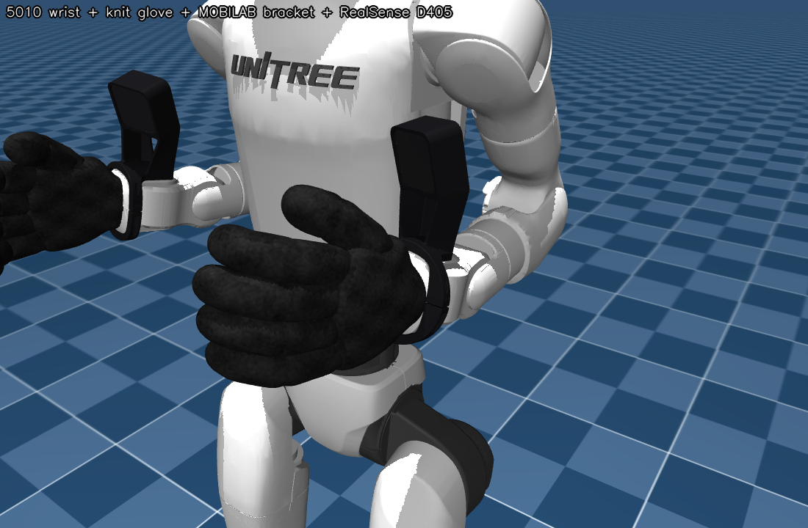
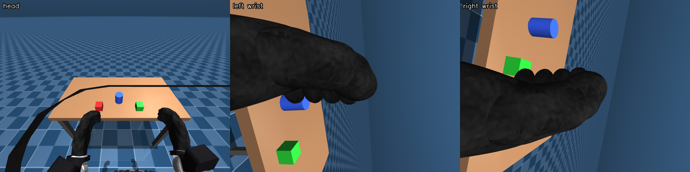
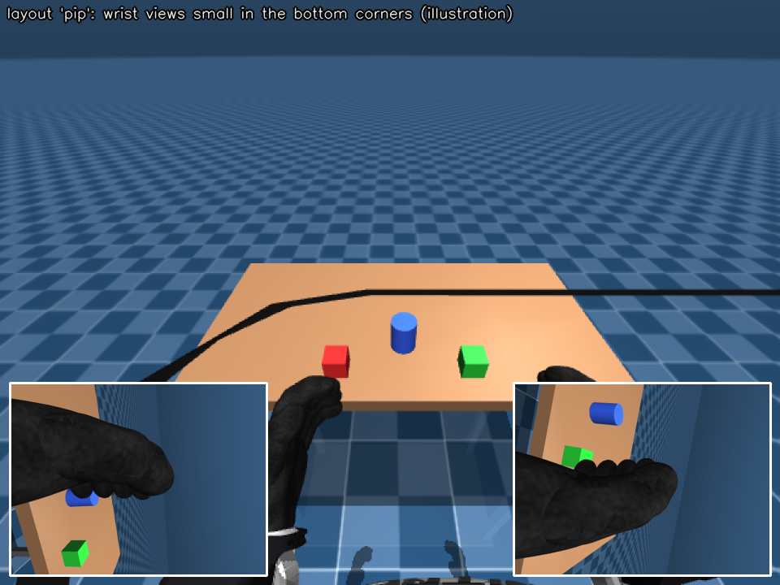
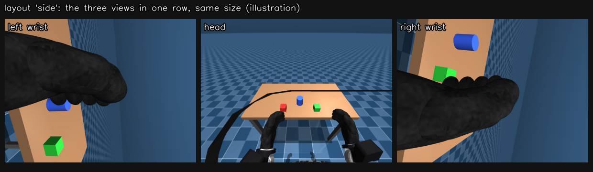

# Stage 2: Wrist cameras



**What you will have at the end of this stage**

- The simulated G1 with the hardware our real robot carries on its wrists: gloved rubber hands and one Intel RealSense D405 camera per wrist on a MOBILAB 3D-printed bracket.
- Three camera streams (head, left wrist, right wrist), served like on the real robot.
- The two wrist views inside the Quest 3, next to the head view, in a layout you can switch while teleoperating (not yet checked on a physical Quest 3).

**Prerequisites**

- [Stage 1](../01_teleop/README.md) works: the sim runs and the Quest connects.
- New words (add-on, teleimager, PiP): see the [glossary](../docs/GLOSSARY.md).

## 1. Start the simulator with the wrist cameras

```bash
scripts/run_sim.sh --addon wrist_cameras
```

You should see the same demo table as in stage 1, the hands now wearing black gloves with a camera above each wrist, and:

```
[sim] add-ons: wrist_cameras
[sim] image server: config tcp://*:60000 | head_camera 1280x480 :55555, left_wrist_camera 640x480 :55556, right_wrist_camera 640x480 :55557 @ 30 fps
```



## 2. What the add-on puts on the robot

The add-on is one file, [wrist_cameras.py](wrist_cameras.py). It edits the robot model in memory when the sim starts. Unitree's model file is not touched.

| Part | Source | In the sim |
|---|---|---|
| 5010 wrist yaw links | Unitree `unitree_ros` g1_description | Replace the 4010 wrist meshes of the MuJoCo model |
| Knit gloves over the rubber hands | Built from Unitree's rubber hand mesh ([assets/src/blender_build_wrist.py](assets/src/blender_build_wrist.py)) | Collide, with high friction (knit glove with rubber pads) |
| D405 wrist mount for the 5010 wrist | [MOBILAB-UDESC/cad-models](https://github.com/MOBILAB-UDESC/cad-models), `unitree-g1/d405-wrist-mount-5010` | Visual only, real mass (about 50 g with the ring clamp) |
| Intel RealSense D405 | Intel `realsense2_description` mesh | Visual only, real mass (about 60 g) |
| Cameras `cam_left_wrist`, `cam_right_wrist` | Pose fitted to our real wrist videos (stage 3 tool `fit_wrist_rotation.py`) | 640x480, about 64 degrees vertical field of view (D405 datasheet) |

| Camera | teleimager topic | Port |
|---|---|---|
| Head (stereo in the demo scene, mono in the lab scene) | `head_camera` | 55555 |
| Left wrist | `left_wrist_camera` | 55556 |
| Right wrist | `right_wrist_camera` | 55557 |

## 3. See the wrist views in the headset

Start teleop as in stage 1:

```bash
scripts/run_teleop.sh --controller
```

You should see this line in terminal 2 during start-up:

```
[wrist views] left 640x480, right 640x480; layout pip; toggle: page button, VR button, left X
```

Three layouts exist:

| Layout | What you see |
|---|---|
| `pip` (default) | Head view at full size. The wrist views are small, in the bottom corners of the head view. |
| `side` | Head and both wrist views in one row, all the same size. The head view shrinks so the row fits the Quest field of view. |
| `off` | Exactly the plain xr_teleoperate display. |

| `pip` | `side` |
|---|---|
|  |  |

Four ways to switch. Each press goes to the next layout: `pip` -> `side` -> `off` -> `pip`.

| Where | How |
|---|---|
| In VR, controller mode | Press **X** on the left controller |
| In VR, any mode | Point at the floating **WRIST VIEW** button (up and to the left of where you look) and click with the controller ray, or pinch |
| On the web page, before entering VR | Click the button at the bottom-left of the page |
| At start | `scripts/run_teleop.sh --controller --wrist-layout side` |

Each switch prints a line like `[wrist views] layout pip -> side (left X)` in terminal 2.

Options:

| Option | Default | What it does |
|---|---|---|
| `--wrist-layout pip\|side\|off` | `pip` | Layout at start |
| `--wrist-side-span DEG` | 94 | `side` layout: total horizontal angle the three views may cover |
| `--plain` | off | Run Unitree's `teleop_hand_and_arm.py` directly, without the wrist views |

Good to know:

- [teleop_views.py](teleop_views.py) is a launcher. It swaps two display classes in memory and then runs Unitree's `teleop_hand_and_arm.py` as it is. No file in `third_party/xr_teleoperate` is modified.
- Recordings made with `--record` keep the raw head image. The wrist views are only drawn in the headset.
- If the sim has no wrist cameras (stage 1 demo without the add-on), the display is exactly plain xr_teleoperate. Terminal 2 then prints `[wrist views] no wrist camera stream to show ...`.

## 4. Known limits

| Item | Status |
|---|---|
| Layouts, switching logic, frame transport | Verified with unit tests and a simulated web client |
| In-VR **WRIST VIEW** button and the **X** button | **Not yet checked on a physical Quest 3** |
| Clicking the in-VR button with the trigger | If a gripper is attached (`--ee ...`), the same trigger pull also closes that gripper |
| Real robot | The launcher only changes the display, but it was only run against the sim |
| Camera intrinsics | Datasheet field of view. Replace `WRIST_CAM_FOVY` in `wrist_cameras.py` with your unit's value if you have it. |

## 5. Run the tests (optional)

```bash
source scripts/env.sh g1sim
python -m pytest 02_wrist_cameras/tests -q
```

You should see all tests pass. They need no sim and no headset.

## 6. Rebuild or change the assets (optional)

The ready-made meshes are in [assets/mesh](assets/mesh). Their sources are in [assets/src](assets/src):

| Script | What it makes |
|---|---|
| [assets/src/blender_build_wrist.py](assets/src/blender_build_wrist.py) | Glove meshes and the bracket + clamp mesh. Run with `blender -b -P 02_wrist_cameras/assets/src/blender_build_wrist.py`. |
| [assets/src/adapt_5010.py](assets/src/adapt_5010.py) | How the original bracket was re-cut for the 5010 wrist (CAD script, kept for reference) |

To print the real bracket, use the files in [MOBILAB-UDESC/cad-models](https://github.com/MOBILAB-UDESC/cad-models).

To write your own add-on (another camera, a tool, a scene), see the add-on section of [docs/ARCHITECTURE.md](../docs/ARCHITECTURE.md).

## Troubleshooting

- **`[wrist views] no wrist camera stream to show`**: the sim was started without `--addon wrist_cameras` (or without `--scene lab`). Restart the sim, then teleop.
- **Wrist views missing after switching display mode**: they are only drawn in the `immersive` and `ego` display modes of xr_teleoperate, not in `pass-through`.
- **The gloves look cut open near the camera**: only happens if you changed `znear` or the model extent. The add-on sets a 5 mm near plane so the gloves stay visible.
- **The headset video got slower**: three cameras are rendered instead of two. Run the sim with `--no-viewer`, or switch the layout to `off`.
- **X does nothing**: X only works in controller mode (`--controller`). In hand-tracking mode use the WRIST VIEW button or the page button.

More cases: [docs/TROUBLESHOOTING.md](../docs/TROUBLESHOOTING.md).

**Next: [Stage 3 - real2sim](../03_real2sim/README.md)**
