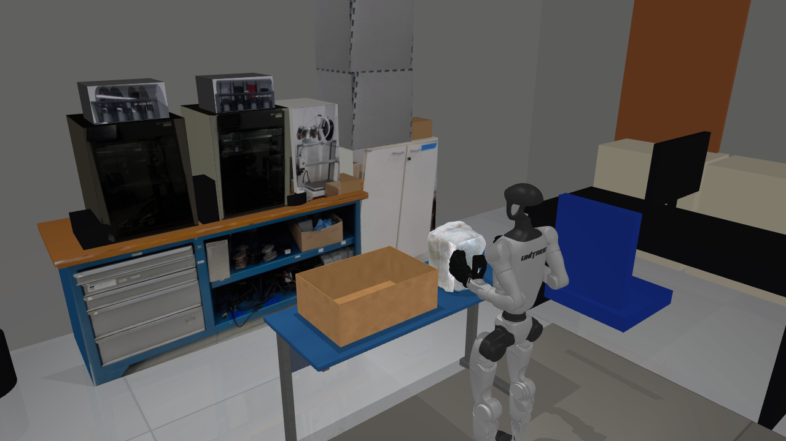
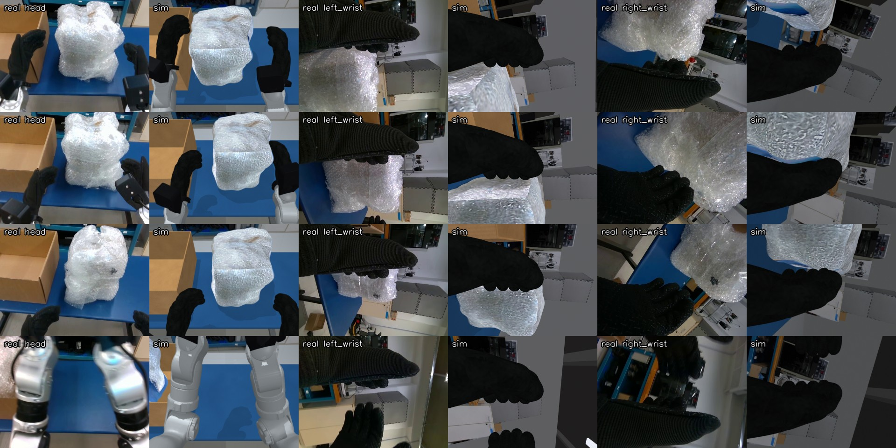
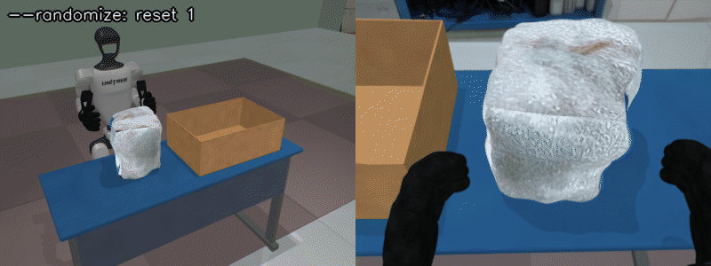
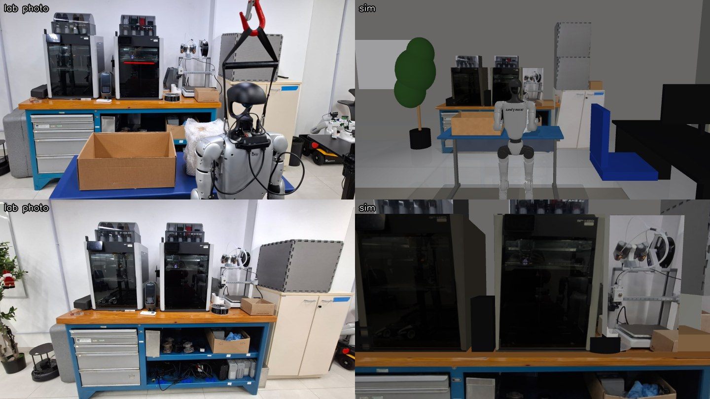

# Stage 3: Real2sim - our lab task in simulation



**What you will have at the end of this stage**

- Part A: our real desk task running in the sim. The G1 stands at a desk and has to put a bubble-wrapped box into a cardboard box. Cameras, objects and colours are matched to recordings of the real robot.
- Part B: a step-by-step method, with tools, to rebuild **your own** real setup in simulation.

**Prerequisites**

- [Stage 1](../01_teleop/README.md) installed. [Stage 2](../02_wrist_cameras/README.md) read (the lab scene uses the wrist cameras).
- For Part B: the `g1lab` env (`install/setup_g1lab_env.sh`, see [stage 4](../04_recording/README.md)), `ffmpeg` (`sudo apt install ffmpeg`), and a LeRobot dataset recorded on your real robot.
- Blender 4.x and `uv`: only for step 2 (Blender script) and the STEP converter.
- New words (real2sim, sim2real, MJCF, add-on, domain randomization): see the [glossary](../docs/GLOSSARY.md).

> The calibration numbers live in the code ([lab_scene.py](lab_scene.py), [scene_lab.xml](scene_lab.xml), [calib/photometric.json](calib/photometric.json)), not in this guide. How close the copy is, and where it is not, is listed in [section 5](#5-how-close-is-it).

---

# Part A: Run our lab demo

## 1. Start the lab scene

```bash
scripts/run_sim.sh --scene lab
```

You should see the G1 at a blue desk with a cardboard box on its left and a bubble-wrapped box in front of it, inside a model of our lab room, and:

```
[sim] DDS domain 1 on 'lo' | lowstate @500Hz | objects: ['wrapped_box']
[sim] add-ons: wrist_cameras, lab_scene
[sim] image server: config tcp://*:60000 | head_camera 640x480 :55555, left_wrist_camera 640x480 :55556, right_wrist_camera 640x480 :55557 @ 30 fps
```

- `--scene lab` is a shortcut for `--addon lab_scene`. It loads the wrist cameras of stage 2 by itself.
- The head camera is **mono** here (one 640x480 image), like the head camera of the real recordings. The demo scene of stage 1 is stereo.

## 2. The real setup it copies



| Item | Measured on the real setup |
|---|---|
| Desk | 125 x 45 cm, 74 cm high |
| Robot | Hip centre 22 cm from the desk's near edge and 46 cm from the desk's right end |
| Cardboard box | 49 x 33 x 18 cm, open top, glued to the desk, on the robot's left |
| Wrapped box | 23 x 23 x 27 cm, under 0.5 kg, starts in front of the robot |
| Head camera | Intel RealSense D435i colour stream, 640x480, about 43 degrees vertical field of view |
| Wrist cameras | Intel RealSense D405, 640x480, about 64 degrees vertical field of view, on MOBILAB brackets |
| Real dataset | 52 teleoperated episodes, LeRobot v3.0, 30 fps, 14 arm joints, cameras `cam_head`, `cam_left_wrist`, `cam_right_wrist` |

The camera names in the sim are the same as the dataset keys, so sim and real data can be mixed (stage 5).

## 3. Teleoperate the task

```bash
scripts/run_teleop.sh --controller
```

Connect the Quest as in stage 1. Squeeze the wrapped box between the palms, lift it, twist the waist to the left with the right stick, and lower the box into the cardboard box.

When the wrapped box rests inside the cardboard box, terminal 1 prints:

```
[sim] task success
```

The same flag is published on the DDS topic `rt/rewards_state`, in the format Unitree's Isaac simulation uses. Stage 4 uses it to keep only successful episodes.

## 4. Reset and randomize

- Key **0** in the MuJoCo window resets the robot and the objects.
- With `--randomize`, every reset draws new object start poses, light levels, material tints and a small camera jitter.

```bash
scripts/run_sim.sh --scene lab --randomize
```



| Option (lab scene only) | What it does |
|---|---|
| `--randomize` | Random object start poses and appearance on every reset |
| `--seed N` | Random seed for `--randomize` |
| `--head-fovy DEG` | Override the head camera's vertical field of view |

These three options come from the add-on. `scripts/run_sim.sh --scene lab --help` lists them.

## 5. How close is it

| Aspect | State |
|---|---|
| Desk, boxes, robot position | From tape measurements. |
| Head camera | Pose and field of view fitted to the 52 real episodes. Matches the real frames closely. |
| Wrist cameras | Orientation self-calibrated from the real videos, position from the bracket CAD. Hands and objects match; the far background sits a few degrees lower than in the real images (next row). |
| Robot posture | The real robot hangs on its gantry and leans forward a few degrees. The sim keeps it upright. The head camera calibration absorbs this; the wrist views do not. |
| Wrapped box | Shape rebuilt from the recordings, texture taken from real head and wrist frames. One fixed look; the real wrap changes shape when squeezed. |
| Room (workbench, printers, cabinet, foam cubes) | Sizes from photos, positions estimated from the wrist recordings to about 10-20 cm. It is a believable background, not a survey. |
| Colours and light | Fitted to the recordings, then three values corrected by hand (see `note` in `calib/photometric.json`). |
| Image noise and sharpness | Matched to the statistics of the real 640x480 streams, per camera. |
| Gloves | The sim glove is the rubber hand made 7 mm thicker. It looks bulkier than the real knit glove. |
| Frame rate | On a laptop with an integrated GPU the three cameras render at about 25 fps while recording, so some recorded frames repeat. |

---

# Part B: Make your own real2sim scene

The lab scene was built with the method below. Follow it with your own desk, objects and recordings. Each step names the file to copy from.

All tool commands run in the `g1lab` env, from the repository folder:

```bash
source scripts/env.sh g1lab
```

## 1. Measure the real setup

- Write down the size of every object the robot touches or sees up close, in cm.
- Measure where things stand **relative to the robot**: distance from the hip centre to the table edge (forward) and to one table end (sideways), and the table height.
- Take photos: each object square-on, the table surface, and the room behind the table as the robot sees it. Ours are in [assets/lab/ref](assets/lab/ref) and [assets/lab/ref/room](assets/lab/ref/room).
- Convention used everywhere: the robot's pelvis is at the origin, **+x is forward, +y is the robot's left, z is up**, in metres.

## 2. Model the props

Steps 2-3 regenerate files that are already in git (`blender_build_lab.py` also writes an older wrapped box). Skip them to keep ours; `git checkout 03_real2sim/assets/lab` restores them.

Two options. Mix them freely.

| Option | When | Example |
|---|---|---|
| Plain MJCF boxes and cylinders | Simple shapes, quick start | [../01_teleop/g1sim/scenes/scene_demo.xml](../01_teleop/g1sim/scenes/scene_demo.xml) |
| Meshes built by a script (Blender or Python) | The cameras see the object up close | [assets/lab/blender_build_lab.py](assets/lab/blender_build_lab.py) |

```bash
blender -b -P 03_real2sim/assets/lab/blender_build_lab.py
```

- The script builds the desk, the cardboard box and a first wrapped box at their real sizes and exports one OBJ per material into `assets/lab/mesh/`.
- Keep **visual meshes and collision shapes separate**: in [scene_lab.xml](scene_lab.xml) every object is drawn with a mesh but collides with a few simple boxes. Simple collision shapes are faster and more stable.
- An object that should move gets a `<freejoint/>`. An object fixed in the real world (our glued cardboard box) stays a static body.
- CAD parts in STEP format can be converted with [tools/step_to_stl.py](tools/step_to_stl.py):

```bash
uv run --with cascadio --with trimesh python 03_real2sim/tools/step_to_stl.py part.step
```

## 3. Make textures from photos and camera frames

| Script | What it makes | Input |
|---|---|---|
| [assets/lab/make_textures.py](assets/lab/make_textures.py) | Tiling textures for desk, cardboard and bubble wrap. Colours are sampled from clean patches of the photos; grain and patterns are synthesised. | `assets/lab/ref/*.jpg` |

```bash
python 03_real2sim/assets/lab/make_textures.py
```

The wrapped box's final look (mesh and texture) is made later, in step 5: it needs frames from the real recordings.

## 4. Place everything by your measurements

- Write the scene file. Copy [scene_lab.xml](scene_lab.xml) and change the positions. Its header comment shows how each measurement turns into a coordinate.
- Check it alone before adding calibration:

```bash
scripts/run_sim.sh --scene path/to/your_scene.xml --addon wrist_cameras
```

You should see your scene around the robot. `--scene` accepts any environment MJCF file.

## 5. Record on the real robot and extract references

You need a LeRobot dataset of the real task (ours: 52 episodes). Ours is on the Hub.

The datasets are not public yet: until they are, use your own recordings or ask the lab for the folders.

```bash
hf download "mobilab-udesc/g1_pick_cube_real" --repo-type dataset --local-dir datasets/pick_cube_real
```

Extract joint states and camera frames for calibration:

```bash
python 03_real2sim/tools/extract_real_refs.py --dataset datasets/pick_cube_real \
    --episodes 0 7 23 --frames 0 60 150 240 300 --all-first-frames \
    --video-cams cam_left_wrist cam_right_wrist --color-step 15 \
    --out 03_real2sim/calib/real_refs
```

You should see one line per episode, like `episode 0: 333 frames, dumped [0, 60, 150, 240, 300]`, and files in `03_real2sim/calib/real_refs/` (this folder is not in git).

| Option | What it dumps | Needed by |
|---|---|---|
| `--episodes`, `--frames` | Joint states (`epNNN.npz`) and the three camera images at those frames | `calibrate_replay.py`, `make_wrapped_box.py` |
| `--all-first-frames` | States and the first head image of **every** episode | `kinematic_object_poses.py`, `fit_head_full.py`, `fit_objects.py` |
| `--video-cams` | Every frame of those cameras, small and grey | `fit_wrist_rotation.py` |
| `--color-step N` | Every Nth frame of all cameras, small, in colour | `fit_materials.py`, `fit_room.py` |

Now build the wrapped box's final look from those frames:

| Script | What it makes | Input |
|---|---|---|
| [assets/lab/make_wrapped_box.py](assets/lab/make_wrapped_box.py) | The wrapped box's final mesh (a soft, bulging box) and its texture, built **from frames the robot's own cameras recorded**: the head camera for the face toward the robot and the top, wrist-camera close-ups for the faces the palms squeeze. Needs no Blender. | `calib/real_refs/` |

```bash
python 03_real2sim/assets/lab/make_wrapped_box.py
```

- It replaces the first wrapped box of steps 2-3 (same file names, so the scene file does not change).
- Why use the robot's own frames: the texture then has the right detail at the scale each camera sees the object, which a phone photo does not give.

## 6. Get the object start poses from kinematics

Where was the object in each real episode? The robot tells you: at the moment of the grasp the object sits between the palms. Forward kinematics of the recorded joints gives that point.

```bash
python 03_real2sim/tools/kinematic_object_poses.py
```

You should see `52 episodes -> .../calib/kinematic_wrap.json`.

- Use the mean as the object's start pose in the scene file and the spread as the randomization range.
- [tools/fit_objects.py](tools/fit_objects.py) is an image-based cross-check: it estimates the object poses from the first head frame of each episode and writes `calib/object_fits.json`. It renders through the head camera, so run it after step 7.

```bash
python 03_real2sim/tools/fit_objects.py --episodes 0 7 23
```

## 7. Calibrate the cameras against the real recordings

The idea: put the simulated robot at the **recorded joint angles** of a real frame, render the sim cameras, and compare with the real image. Then adjust the camera pose until they match.

First look at where you stand:

```bash
python 03_real2sim/tools/calibrate_replay.py --episode 0 --frames 0 60 150 --out calib_sheet.jpg
```

You should get `calib_sheet.jpg`: for each frame and camera, the real image, the sim image and a 50 % blend.

Then fit:

| Tool | What it finds | How |
|---|---|---|
| [tools/fit_wrist_rotation.py](tools/fit_wrist_rotation.py) | Orientation of the wrist cameras on the wrists (and optionally their focal length) | The wrist's rotation between two frames is known from the joints. The background's motion in the image then fixes the camera's orientation. |
| [tools/fit_head_full.py](tools/fit_head_full.py) | Head camera pitch, position offset and field of view | Compares silhouettes (object at its position from step 6, desk, gloves) between real and sim first frames |
| [tools/fit_head_desk.py](tools/fit_head_desk.py) | A refinement of the head camera using only the desk and the gloves | Useful before the object positions are known |

```bash
python 03_real2sim/tools/fit_wrist_rotation.py
```

```bash
FIXED_FOVY=43 python 03_real2sim/tools/fit_head_full.py
```

- `fit_wrist_rotation.py` fits both wrists and prints a `WRIST_CAM_CALIB[...]` line for each; copy the `quat` values. Set `FIXED_F=<focal length in pixels at 640x480>` to keep the datasheet focal length.
- `fit_head_full.py` searches the field of view too unless `FIXED_FOVY` is set. It reads `calib/kinematic_wrap.json` from step 6.
- The tools **print** the fitted values. Copy them into your add-on: the wrist camera pose is in `WRIST_CAM_CALIB` in [../02_wrist_cameras/wrist_cameras.py](../02_wrist_cameras/wrist_cameras.py), the head camera constants are at the top of [lab_scene.py](lab_scene.py).
- Run `calibrate_replay.py` again after each change and look at the blend.

## 8. Model the room behind the table

A policy also sees the background. [assets/lab/make_room.py](assets/lab/make_room.py) builds ours: workbench, 3D printers, cabinet, walls, ceiling.



```bash
python 03_real2sim/assets/lab/make_room.py
```

It writes textures, meshes and [scene_room.xml](scene_room.xml), which `scene_lab.xml` includes.

- **Scale** comes from objects of known size in the photos (for us: the printers on the workbench).
- **Where things stand** comes from the recordings themselves, not from a tape measure: the wrist camera pose is known from the recorded joints, so the direction and apparent size of a known object in a wrist image give its distance and position. The header comment of `make_room.py` shows the calculation.
- Front faces carry perspective-corrected crops of a photo taken square-on.
- [tools/fit_room.py](tools/fit_room.py) scores a placement against the calibrated cameras (coarse colour classes: blue frame, wood, beige, dark, white) and prints a suggested shift and yaw for the constants in `make_room.py`. The score is a weak signal when the background is far away and partly hidden by the hands: treat its output as a hint and always look at a real-vs-sim sheet (`tools/calibrate_replay.py`) before you accept it.

```bash
python 03_real2sim/tools/fit_room.py
```

## 9. Match colours and light (photometric match)

```bash
python 03_real2sim/tools/fit_materials.py
```

Run it a second time, starting from the first result. This settles materials whose colour hit a limit in the first pass:

```bash
TEXTURE_GAIN_START=1 python 03_real2sim/tools/fit_materials.py
```

- For sampled real frames it compares, material by material, the mean real colour with the mean rendered colour and corrects the material colours, the light level and a gain per camera.
- Only pixels whose real colour looks like the material are compared (`MATERIAL_CLASS` in the tool: the desk is blue, the cardboard is brown, ...). The sim and real outlines never overlap exactly, and without this gate the neighbours' colours leak in.
- A material that is still too dark at full colour gets a `texture_gain_rgb`: the sim brightens the texture itself.
- It writes `calib/photometric.json`. `lab_scene.py` loads this file when the sim starts, if it exists.
- Check the result by eye and fix what is off by hand in the JSON. Ours has three hand corrections; the `note` field says which.
- Lighting tip: an indoor room with rows of ceiling lamps is mostly ambient light. In MuJoCo that means a high `headlight ambient` and weak directional lights, otherwise shadows are far harder than in the real images.
- `lab_scene.py` also adds a little blur and sensor noise to each image, like the real 640x480 streams.

## 10. Validate: replay the real actions in the sim

The physics check. Each real episode starts from its recorded first state, the object is placed at its position from step 6, and the recorded actions are replayed open loop.

```bash
python 03_real2sim/tools/replay_real_actions.py --episodes 0 7 23 --video replay.mp4
```

You should see one line per episode and a summary like `SUCCESS n/N  lifted>15cm n/N`.

- If mass, friction and contact softness are realistic, most real episodes also succeed in the sim.
- If the object slips or is not lifted, tune its `mass`, `friction`, `solref` and `solimp` in the scene file and the glove friction in `wrist_cameras.py`, then replay again.
- Without `--episodes` it replays every episode in `calib/kinematic_wrap.json`.

## 11. Add randomization

So that a policy trained in sim does not depend on one exact picture:

- Object poses: `OBJECT_RANGES` in [lab_scene.py](lab_scene.py). Use the spread measured in step 6.
- Appearance: `LabTask.randomize_appearance` changes light intensity and direction, material tints and camera pose by small amounts.
- Motion: the scripted policy of stage 4 also varies speed, grasp height and start pose.

## 12. Wire it in as an add-on

Copy [lab_scene.py](lab_scene.py) and adapt it. An add-on is a Python module with a few optional functions:

| Name | What it does in `lab_scene.py` |
|---|---|
| `REQUIRES = ["wrist_cameras"]` | Loads the wrist cameras first |
| `PROVIDES_SCENE = True` | The add-on attaches its own environment |
| `add_args(parser)` | Adds `--randomize`, `--seed`, `--head-fovy` |
| `build(spec, args, cameras, prefix)` | Attaches the scene, adds the head camera, applies the photometric file |
| `make_task(model, prefix, args)` | Object resets, start pose of the arms, success check |
| `camera_effects(rgb, camera_name)` | Per-camera gain, blur and noise |

Put the module in a folder that is on `PYTHONPATH` (the stage folders are, through `scripts/env.sh`) and start it with `scripts/run_sim.sh --addon your_module`. More: [docs/ARCHITECTURE.md](../docs/ARCHITECTURE.md).

## Troubleshooting

- **`No such file ... calib/real_refs/...`**: run step 5 first, with the option that tool needs (see the table in step 5).
- **`ffmpeg: not found`** in `extract_real_refs.py`: `sudo apt install ffmpeg`.
- **`calibrate_replay.py` shows a black "real" tile**: that frame was not extracted. Use frame numbers you passed to `--frames` in step 5.
- **The head camera sees the inside of the robot's head**: Unitree's head mesh is a closed shell. `lab_scene.py` hides it from the cameras (render group 5) and shows it only in the desktop viewer. The pelvis and legs are hidden from the cameras the same way (no camera sees them behind the desk, and it saves render time). Do the same in your add-on.
- **Objects jump at reset with `--randomize`**: two start ranges overlap. `LabTask.reset_objects` keeps a minimum gap between our two boxes; add the same check for your objects.
- **`--randomize` is "unrecognized"**: it only exists together with `--scene lab` (or your own add-on that defines it).

More cases: [docs/TROUBLESHOOTING.md](../docs/TROUBLESHOOTING.md).

**Next: [Stage 4 - recording](../04_recording/README.md)**
