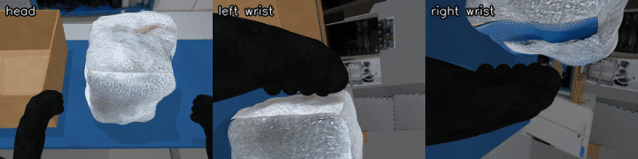
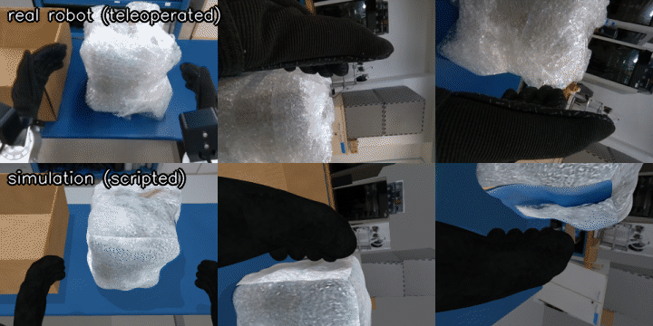

# Stage 4: Record episodes



**What you will have at the end of this stage**

- A LeRobot v3.0 dataset of the box-into-box task, in the same format as our real-robot dataset.
- Three ways to fill it: VR teleop, a scripted policy ("code-as-policy"), or a remote VLA model.
- The dataset cleaned (bad episodes removed), checked, and ready to upload to the Hugging Face Hub.

**Prerequisites**

- [Stage 3](../03_real2sim/README.md) Part A works (`scripts/run_sim.sh --scene lab`).
- For VR teleop: a Quest 3 ([stage 1](../01_teleop/README.md)).
- New words (LeRobot dataset, episode, code-as-policy, VLA, MCP): see the [glossary](../docs/GLOSSARY.md).

Reference pages for this stage: [g1lab/README.md](g1lab/README.md) (recorder, writer and converter in detail), [g1lab/MCP.md](g1lab/MCP.md) (AI assistant control), [unitree_bridge/README.md](unitree_bridge/README.md) (Unitree's tools).

## 1. Install the recording env (once)

Stages 4-5 use a second conda env, `g1lab`, with LeRobot 0.4.1. Run it after `install/install.sh`:

```bash
install/setup_g1lab_env.sh
```

You should see a line like `lerobot 0.4.1 | mujoco 3.17.0 | pinocchio 3.1.0`, then `PyAV ... with libsvtav1: OK` and `g1lab env ready.`

- pip prints one `rerun-sdk` / numpy conflict warning. That is expected. Do not upgrade numpy.

Check it (about 1 minute):

```bash
source scripts/env.sh g1lab
python -m pytest 04_recording -q
```

You should see the tests pass (some are skipped: they need a running sim or the real dataset).

In every new terminal of this stage, activate the env first:

```bash
source scripts/env.sh g1lab
```

## 2. The dataset format

| Field | Content |
|---|---|
| Format | LeRobot v3.0, 30 fps |
| `observation.state` | Measured joint positions in radians |
| `action` | Commanded joint targets in radians |
| `observation.images.cam_head`, `cam_left_wrist`, `cam_right_wrist` | 640x480 videos (AV1) |

Two joint layouts exist. Pick one per dataset.

| robot_type | Joints | Use |
|---|---|---|
| `Unitree_G1_ArmsOnly_3Cam` | 14: left arm (shoulder pitch/roll/yaw, elbow, wrist roll/pitch/yaw), then right arm | The real dataset. Policies that only move the arms. |
| `Unitree_G1_ArmsWaist_3Cam` | The 14 + `kWaistYaw` | Episodes that twist the waist. **Default of our recorder.** |

Why the waist matters: in our task the robot turns its torso to reach the cardboard box. Unitree's `xr_teleoperate --record` saves only the arms, so the turn is lost. Our recorder saves it.

## 3. Source A: VR teleop

Three terminals.

Terminal 1, the sim:

```bash
scripts/run_sim.sh --scene lab --randomize
```

Terminal 2, teleop (connect the Quest as in stage 1, press **r**):

```bash
scripts/run_teleop.sh --controller
```

Terminal 3, the recorder:

```bash
source scripts/env.sh g1lab
python -m g1lab.record_live --root datasets/teleop_waist --task "put the wrapped box inside the cardboard box"
```

You should see:

```
[record] sim domain 1 | 15 joints (+waist) -> datasets/teleop_waist (0 episodes there) | waist action: auto
[record] keys: s = start/stop+save, d = discard, q = quit
[record] idle    0 fr | src arm_sdk | waist +0.00 | success 0 | saved 0 disc 0 | queue 0
```

The last line refreshes once per second. `src` shows who is commanding the robot: `arm_sdk` = controller-mode teleop, `lowcmd` = hand-tracking teleop or a script, `-` = nobody.

For each episode:

1. Press **s** in terminal 3. The status line shows `REC ep 0`.
2. Do the task in VR. Twist the waist with the right stick.
3. Press **s** again to stop and save. Or press **d** to throw the attempt away.
4. Click the MuJoCo window and press **0** to reset the scene. Start again.
5. Press **q** when done. Wait for `[record] done: saved episodes [...]`. Saving encodes video and takes 15-20 s per episode.

| Key | What it does |
|---|---|
| **s** | Start an episode / stop and save it |
| **d** | Discard the running episode |
| **q** | Quit (an unsaved episode is dropped) |

| Option | Default | What it does |
|---|---|---|
| `--root DIR` | required | Dataset folder. Episodes are appended if it exists. |
| `--task TEXT` | the box task | Task sentence stored with every episode |
| `--no-waist` | off | Record 14 joints (`Unitree_G1_ArmsOnly_3Cam`) |
| `--auto-success` | off | Stop and save when the sim reports success |
| `--only-success` | off | Discard episodes that end without success |
| `--auto-start` | off | Start an episode on every sim reset request (`rt/reset_pose/cmd`) |
| `--episode-seconds S` | 0 (off) | Stop and save after S seconds |
| `--max-episodes N` | 0 (off) | Quit after N saved episodes |
| `--target sim\|real` | `sim` | `real` listens to the real robot (DDS domain 0, image server on the robot's PC2) |
| `--domain`, `--image-port` | 1, 60000 | For a second sim started with `--domain N --port-offset M` |

- The recorder is **read-only**. It only listens (DDS topics and camera streams) and never commands the robot. It can run next to any controller: xr_teleoperate, the scripted policy, a VLA, `run_act.py`.
- Handy for teleop: `--auto-success --only-success` saves an episode by itself as soon as the box rests in the cardboard box.
- Full list: `python -m g1lab.record_live --help`.

### Alternative: Unitree's own recorder

`scripts/run_teleop.sh --controller --record --task-name box_into_box` uses xr_teleoperate's recorder (press **s** in terminal 2). It writes JSON + JPEG folders to `third_party/xr_teleoperate/teleop/utils/data/box_into_box/`, **arms only, no waist**. Convert them in step 7.

## 4. Source B: code-as-policy (scripted)

The idea: instead of a person or a neural network, a **short Python program** decides the motion. It reads the object poses from the sim, computes where the hands must go, and moves them with inverse kinematics. An AI assistant can write such a program, or you can. Ours is [g1lab/scripted/box_into_box.py](g1lab/scripted/box_into_box.py), about 200 lines:

1. Read the poses of both boxes (`rt/sim_state`).
2. Reach beside the wrapped box, lower the hands, squeeze.
3. Lift, turn the waist toward the cardboard box, carry.
4. Lower inside, release, go back to rest.

Every episode is randomized (start pose, speed, squeeze width, grasp height, plus the sim's `--randomize`). About 45-50 % of attempts succeed. **Only successful episodes are saved.**

Terminal 1:

```bash
scripts/run_sim.sh --scene lab --randomize --no-viewer
```

Terminal 2:

```bash
source scripts/env.sh g1lab
python -m g1lab.scripted.box_into_box --episodes 20 --root datasets/sim_scripted_waist --repo-id local/sim_scripted_waist
```

You should see one line per attempt and a summary:

```
[scripted] attempt 1: SUCCESS (5xx frames, {...}) -> 1/20
[scripted] attempt 2: fail (5xx frames, {...}) -> 1/20
...
[scripted] 20 successful of 43 attempts (47%)
```

- Remove `--no-viewer` to watch. Omit `--root` to run without recording.
- It stops after 3 x `--episodes` attempts unless you set `--max-attempts`.
- The dataset has 15 joints (`Unitree_G1_ArmsWaist_3Cam`).

Everything goes through one class, `G1Arms` ([g1lab/robot_io.py](g1lab/robot_io.py)), which talks to the sim and to the real robot the same way:

```python
from g1lab.robot_io import G1Arms
robot = G1Arms("sim", waist=True)       # or "real"
obs = robot.observe()                   # {"state": ..., "images": {cam_head, cam_left_wrist, cam_right_wrist}}
poses = robot.sim_state()               # object poses and success flag (sim only)
q, tau = robot.ik(left_T, right_T)      # 4x4 wrist poses -> 14 arm joint angles
robot.move_to(q, duration=2.0)          # smooth move
robot.command_waist(0.4)                # waist yaw in radians
```

To write your own policy, copy `box_into_box.py` and change `run_episode`.

**Step-by-step control by an AI assistant.** The MCP server lets an assistant such as Claude Code look through the cameras and move the arms one tool call at a time, and record what it does. See [g1lab/MCP.md](g1lab/MCP.md).

## 5. Source C: a remote VLA model

A VLA (vision-language-action model) takes camera images and a sentence and returns joint actions. [g1lab/remote_vla.py](g1lab/remote_vla.py) sends the robot's images and joint angles to a model server and plays the returned actions at 30 Hz.

| Backend | Server | Address example |
|---|---|---|
| `dream` | Dream Labs Dream-1 API (HTTPS) | default API address, key in `DREAM_API_KEY` |
| `openpi` | Physical Intelligence openpi policy server (websocket) | `--url ws://gpu-box:8000` |
| `gr00t` | NVIDIA Isaac GR00T inference server (ZMQ) | `--url tcp://gpu-box:5555` |

**Try it without any key or GPU**, against the local mock server. Terminal 1: the lab sim. Terminal 2:

```bash
source scripts/env.sh g1lab
python -m g1lab.vla_mocks dream --port 8642
```

Terminal 3:

```bash
scripts/run_vla.sh --backend dream --url http://127.0.0.1:8642 --max-steps 150
```

You should see `[vla] robot ready (sim), cameras: ['cam_head', 'cam_left_wrist', 'cam_right_wrist']`, the arms moving slowly (the mock answers with a smooth test motion, not a real policy), then `[vla] go_home()` and `[vla] done: 0/1 successful episodes`.

**With a real provider:**

```bash
export DREAM_API_KEY=<your key>
scripts/run_vla.sh --backend dream --prompt "put the wrapped box inside the cardboard box" \
    --record datasets/vla_rollouts --repo-id local/vla_rollouts --save-on success
```

- **Never write API keys into files.** Export them in the terminal only. `openpi` and `gr00t` read `OPENPI_API_KEY` / `GR00T_API_TOKEN` if their server needs one.
- `--record` saves the rollouts as a 14-joint dataset (the VLA client moves the arms only). `--save-on success` keeps successful episodes only.
- Every action passes a safety filter: joint limits and a maximum change per step (`--max-step-rad`).
- Full list: `scripts/run_vla.sh --help`.

Known limits: the Dream-1 path was tested **only against the mock servers** in [g1lab/vla_mocks.py](g1lab/vla_mocks.py). A general model does not know the G1: the provider must offer a model fine-tuned for this robot (an "embodiment") before it can solve the task.

## 6. Clean the data

Bad demonstrations teach bad behaviour. Remove failed and sloppy episodes before training. Three ways, depending on where the data is.

### a) Unitree's flow, for `xr_teleoperate --record` folders

This is Unitree's recommended practice: watch every episode, delete the failed ones, trim, renumber, then convert. The tools are in [unitree_lerobot](https://github.com/unitreerobotics/unitree_lerobot), cloned by the installer into `third_party/unitree_lerobot`. They need their own env; follow the install section of their README.

Not run by us: unitree_lerobot is not installed on the development PC; the commands follow Unitree's README.

```bash
conda activate unitree_lerobot
pip install PyQt5
cd third_party/unitree_lerobot/data_editor
python data_editor_EN.py
```

1. Click **Select Dataset Path** and choose the task folder, e.g. `third_party/xr_teleoperate/teleop/utils/data/box_into_box`.
2. Play each episode. Delete the failed ones. Trim dead frames at the start and end.
3. Renumber the episode folders after deleting (from `third_party/unitree_lerobot`):

```bash
python unitree_lerobot/utils/sort_and_rename_folders.py --data_dir ../xr_teleoperate/teleop/utils/data/box_into_box
```

4. Convert (step 7).

### b) LeRobot tools, for datasets already in LeRobot format

Get an overview first:

```bash
python -m g1lab.check_dataset datasets/teleop_waist
```

You should see the episode count, the shortest and longest episode, how far each joint moves, joints that never move, and the share of repeated camera frames. Things to look for:

- A very short episode (ours: one real episode of 0.2 s) is a false start. Delete it.
- A joint that never moves (the waist in data recorded without waist motion) needs data with motion mixed in before you train on it, see [stage 5](../05_training/README.md).
- More than a few percent of repeated frames means the camera stream was slower than the 30 Hz recording (in sim: an overloaded PC, see [troubleshooting](../docs/TROUBLESHOOTING.md)).

Watch an episode (opens the rerun viewer):

```bash
lerobot-dataset-viz --repo-id local/teleop_waist --root datasets/teleop_waist --episode-index 0
```

Delete episodes 3 and 7:

```bash
HF_LEROBOT_HOME=$PWD/datasets lerobot-edit-dataset --repo_id teleop_waist \
    --operation.type delete_episodes --operation.episode_indices "[3, 7]"
```

You should see `Episodes: N, Frames: M` with the new counts. The cleaned dataset replaces `datasets/teleop_waist`; the original is kept as `datasets/teleop_waist_old`.

- Write the command exactly like this: `HF_LEROBOT_HOME` is the **parent** folder and `--repo_id` is the folder name. With lerobot 0.4.1, passing `--root` to `lerobot-edit-dataset` fails.
- The remaining episodes are renumbered from 0.

### c) In the sim: automatic success check

The lab sim knows when the task is solved (`[sim] task success`, topic `rt/rewards_state`). Use it so failed attempts never reach the dataset:

- `record_live --only-success` (add `--auto-success` to also stop by itself).
- The scripted policy always keeps successes only.
- `run_vla.sh --save-on success` and `run_act.py --save-on success`.

Still watch a few episodes: "success" only means the box ended up in the cardboard box, not that the motion was good.

## 7. Convert

| You have | You want | Tool |
|---|---|---|
| `xr_teleoperate --record` folders | LeRobot, 14 joints | `g1lab.convert_xr_json` (our converter, tested) |
| `xr_teleoperate --record` folders | LeRobot, with Unitree's own converter | `unitree_bridge.convert` (untested against a real unitree_lerobot install) |
| A 14-joint LeRobot dataset | 15 joints, waist = 0 | `g1lab.pad_waist` |

Our converter (env `g1lab`). `--raw-dir` is the task folder:

```bash
python -m g1lab.convert_xr_json \
    --raw-dir third_party/xr_teleoperate/teleop/utils/data/box_into_box \
    --root datasets/teleop_arms --repo-id local/teleop_arms \
    --task "put the wrapped box inside the cardboard box"
```

Unitree's converter through our wrapper (env `unitree_lerobot`). Here `--raw-dir` is the **parent** of the task folders:

```bash
PYTHONPATH=$PWD/04_recording python -m unitree_bridge.convert \
    --raw-dir third_party/xr_teleoperate/teleop/utils/data \
    --repo-id local/teleop_arms --robot-type Unitree_G1_ArmsOnly_3Cam --output-root datasets
```

It writes to `<output-root>/<repo-id>`: this example writes to `datasets/local/teleop_arms`, not to `datasets/teleop_arms` like our converter above.

Details and the waist caveat: [unitree_bridge/README.md](unitree_bridge/README.md).

Pad a 14-joint dataset (for example the real one) to 15 joints so it can be merged with sim data that moves the waist:

```bash
python -m g1lab.pad_waist datasets/pick_cube_real datasets/real_waist
```

**Warning.** A policy trained **only** on data where the waist never moved has zero variance on that joint, and misbehaves at run time. Train a 15-joint policy only on a mix that contains waist motion. `05_training/run_act.py` prints a warning when a checkpoint has this problem.

## 8. Upload to the Hugging Face Hub

Datasets are not in git. The upload script only **prints** the commands; you review and run them.

```bash
hf auth login
04_recording/hf/upload_datasets.sh "mobilab-udesc"
```

You should see, for each dataset found in `datasets/`, four commands: create a private dataset repo, upload the folder, upload the dataset card, and tag it `v3.0` (LeRobot refuses a Hub dataset without that tag).

| Local folder (default) | Hub name | Card |
|---|---|---|
| `datasets/pick_cube_real` | `mobilab-udesc/g1_pick_cube_real` | [hf/cards/g1_pick_cube_real](hf/cards/g1_pick_cube_real/README.md) |
| `datasets/real_waist` | `mobilab-udesc/g1_pick_cube_real_waist` | [hf/cards/g1_pick_cube_real_waist](hf/cards/g1_pick_cube_real_waist/README.md) |
| `datasets/sim_scripted_waist` | `mobilab-udesc/g1_box_into_box_sim_scripted` | [hf/cards/g1_box_into_box_sim_scripted](hf/cards/g1_box_into_box_sim_scripted/README.md) |

Other folders: set `REAL_DIR`, `REAL_WAIST_DIR` or `SIM_DIR` before the command. Maintainer notes: [docs/PUBLISHING.md](../docs/PUBLISHING.md).



## Troubleshooting

- **`[record] no data: lowstate MISSING, cameras []`**: the sim is not running, or it uses another `--domain` / `--port-offset`. Pass the same `--domain` and `--image-port` (60000 + offset) to the recorder.
- **`[record] ... cameras ['cam_head']` only**: the sim has no wrist cameras. Use `--scene lab` or `--addon wrist_cameras`.
- **The status line shows `src -`**: nothing is commanding the robot. Press **r** in the teleop terminal.
- **Keys do nothing in the recorder**: click terminal 3 first. If it says `stdin is not a terminal`, use `--auto-start` or `--start-now`.
- **A dataset does not load after a crash** (`parquet` errors): the recorder was killed before it finished. Quit with **q** and wait for `[record] done`.
- **`[scripted]` fails every attempt**: the sim is not the lab scene, or another program is also commanding the robot (teleop still running).
- **`no rt/sim_state from the sim`**: start the sim with `--scene lab` on the same domain.
- **`DREAM_API_KEY is not set`**: export it, or point `--url` at the local mock.
- **`lerobot-edit-dataset` fails with a missing `..._old/videos/...` file**: you passed `--root`. Use the `HF_LEROBOT_HOME=...` form from step 6b.
- **`ModuleNotFoundError: No module named 'g1lab'`**: run `source scripts/env.sh g1lab` in this terminal, from the repository folder.

More cases: [docs/TROUBLESHOOTING.md](../docs/TROUBLESHOOTING.md).

**Next: [Stage 5 - training and deployment](../05_training/README.md)**
