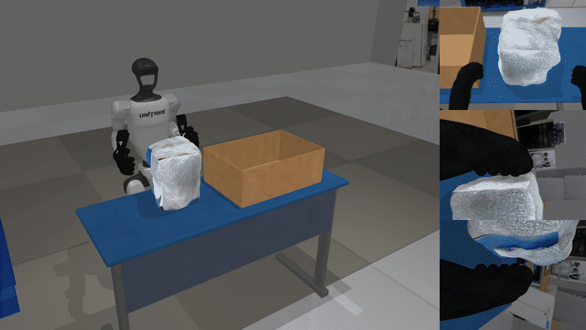
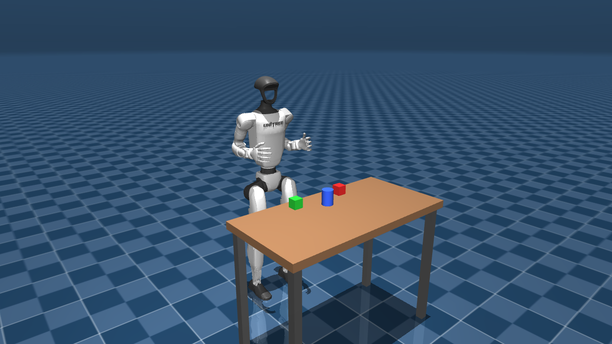
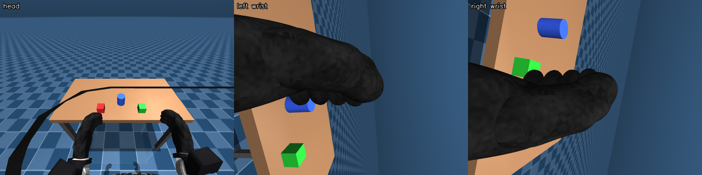
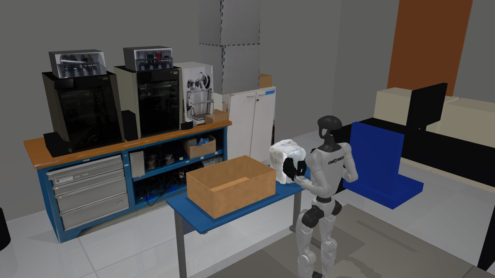
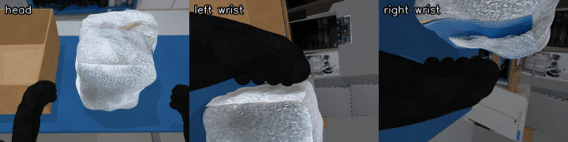
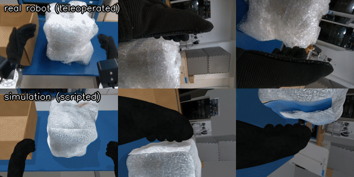
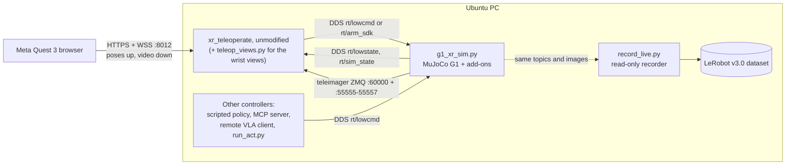
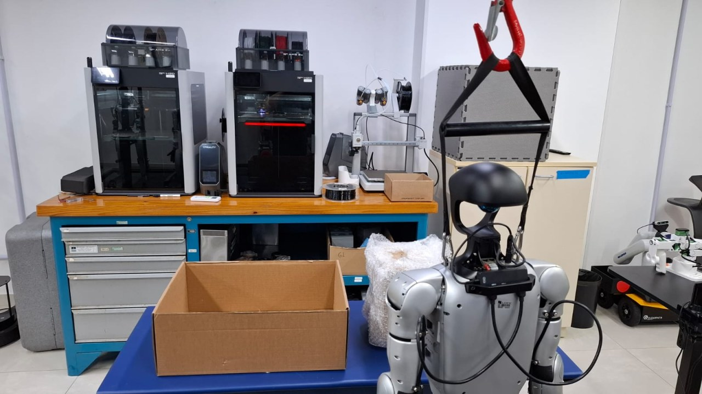

# g1-mujoco-real2sim



A Unitree G1 humanoid (29 DoF, fixed rubber hands with knit gloves, no grippers) simulated in MuJoCo so that it looks like the real robot on the wire: the same Unitree DDS topics and the same teleimager camera protocol. Unitree's own, **unmodified** [xr_teleoperate](https://github.com/unitreerobotics/xr_teleoperate) drives it from a Meta Quest 3. On top of that the repo adds wrist cameras, a real2sim copy of our lab task, episode recording in LeRobot v3.0 format, three ways to produce episodes (VR teleop, code-as-policy, remote VLA APIs), ACT training, a sim rollout runner and a guarded real-robot runner (not yet run on the robot).

Made at MOBILAB (UDESC, Brazil). New words are explained in the [glossary](docs/GLOSSARY.md).

This folder is part of MOBILAB's fork of Unitree's [unitree_lerobot](https://github.com/unitreerobotics/unitree_lerobot) (branch `mobilab`). Everything here is self-contained: all paths are relative to this folder. The rest of the fork is Unitree's code, plus fixes to `unitree_lerobot/eval_robot/eval_g1.py` that let it run the policies trained here (see [05_training](05_training/README.md), step 7).

## 1. What you get

Five stages. Each one works on its own and builds on the previous one.

| | Stage | What you have at the end | Guide |
|---|---|---|---|
|  | **1. Teleop** | The simulated G1 follows your arms through a Quest 3. Walk with the left stick, twist the waist with the right stick. | [01_teleop](01_teleop/README.md) |
|  | **2. Wrist cameras** | Gloved hands, two RealSense D405 wrist cameras on MOBILAB brackets, and the wrist views inside the headset (not yet checked on a physical Quest 3). | [02_wrist_cameras](02_wrist_cameras/README.md) |
|  | **3. Real2sim** | A copy of our real desk task, calibrated against real recordings. A method to build your own. | [03_real2sim](03_real2sim/README.md) |
|  | **4. Recording** | LeRobot v3.0 datasets from VR teleop, from a scripted policy, or from a remote VLA. Tools to clean, convert and upload them. | [04_recording](04_recording/README.md) |
|  | **5. Training** | Real + sim data merged, scripts to train ACT (CPU smoke-tested only) and to run it in sim, and a checklist for the real robot. | [05_training](05_training/README.md) |

## 2. Requirements

- PC with Ubuntu 22.04 or 24.04. Any GPU works, integrated included. About 2 GB of downloads for stages 1-3.
- Meta Quest 3 on the same Wi-Fi as the PC (stages 1-2 and VR recording). Stages 3-5 also run without a headset.
- No real robot is needed until the last step of stage 5.

## 3. Quickstart: sim running in 10 minutes

On a fresh Ubuntu, install the basic tools first (once):

```bash
sudo apt install -y git curl openssl
```

Clone and install. The installer creates the conda env `g1sim`, clones the Unitree repos into `third_party/` at tested commits and makes the HTTPS certificate the Quest needs. It is safe to re-run.

```bash
git clone -b mobilab https://github.com/MOBILAB-UDESC/unitree_lerobot.git
cd unitree_lerobot/g1_mujoco_real2sim
install/install.sh
```

You should see `imports OK`, `lab scene OK: [...]` and `Install finished.` at the end.

Start the simulator (terminal 1):

```bash
scripts/run_sim.sh
```

You should see a MuJoCo window with the G1 in front of a table, and these lines in the terminal:

```
[sim] DDS domain 1 on 'lo' | lowstate @500Hz | objects: ['red_cube', 'green_cube', 'blue_cylinder']
[sim] image server: config tcp://*:60000 | head_camera 1280x480 :55555 @ 30 fps
[sim] base mode: FIXED pelvis | viewer keys: 9 = toggle fixed/free, 0 = reset
```

Check it without a headset (terminal 2):

```bash
source scripts/env.sh g1sim
python 01_teleop/g1sim/test_dds_smoke.py
```

You should see `rt/lowstate rate: ~500 Hz`, the left elbow of the robot moving, and `PASS`.

Next: connect the Quest 3 in [stage 1](01_teleop/README.md), or jump to the lab scene:

```bash
scripts/run_sim.sh --scene lab
```

## 4. Architecture



The simulator answers on the same channels as the real G1, so every program on the right side of the wire runs unchanged against the real robot. Details, ports and topics: [docs/ARCHITECTURE.md](docs/ARCHITECTURE.md).

## 5. Repository layout

```
g1_mujoco_real2sim/
├── install/            install.sh (env g1sim, stages 1-3), setup_g1lab_env.sh (env g1lab, stages 4-5)
├── scripts/            run_sim.sh, run_teleop.sh, run_vla.sh, run_mcp.sh, env.sh, pykill.sh, quest_link.py
├── 01_teleop/          g1sim/g1_xr_sim.py (the simulator), demo scene, DDS smoke test
├── 02_wrist_cameras/   wrist_cameras.py (add-on), teleop_views.py (wrist views in the headset), assets
├── 03_real2sim/        lab_scene.py (add-on), scene_lab.xml, scene_room.xml, assets/lab, calib, tools
├── 04_recording/       g1lab/ (recorder, writer, scripted policy, VLA client, MCP server),
│                       g1lab/check_dataset.py (dataset overview),
│                       unitree_bridge/ (Unitree's cleanup + converter tools), hf/ (upload + cards)
├── 05_training/        merge_datasets.py, train_act.sh, run_act.py
├── docs/               glossary, architecture, troubleshooting, publishing, media, make_media.py (renders the media)
└── third_party/        upstream clones made by install.sh (not in git)
```

## 6. Guides

| Guide | Read it when |
|---|---|
| [01_teleop/README.md](01_teleop/README.md) | You want to drive the simulated robot with the Quest 3 |
| [02_wrist_cameras/README.md](02_wrist_cameras/README.md) | You want wrist cameras and to see them in the headset |
| [03_real2sim/README.md](03_real2sim/README.md) | You want to run our lab scene or rebuild your own setup in sim |
| [04_recording/README.md](04_recording/README.md) | You want to record, clean, convert or upload episodes |
| [05_training/README.md](05_training/README.md) | You want to train ACT and run it in sim or on the robot |
| [docs/ARCHITECTURE.md](docs/ARCHITECTURE.md) | You want to know which process talks to which |
| [docs/GLOSSARY.md](docs/GLOSSARY.md) | A word is new (DDS, teleimager, MJCF, ACT, VLA, ...) |
| [docs/TROUBLESHOOTING.md](docs/TROUBLESHOOTING.md) | Something does not work |
| [docs/PUBLISHING.md](docs/PUBLISHING.md) | You are a maintainer: push the repo, upload datasets |

## 7. Datasets

Datasets are not in git. They live on the Hugging Face Hub, in the [mobilab-udesc](https://huggingface.co/mobilab-udesc) organisation.

| Dataset | Source | Episodes | Joints | robot_type |
|---|---|---|---|---|
| `mobilab-udesc/g1_pick_cube_real` | Real robot, VR teleop | 52 | 14 arms | `Unitree_G1_ArmsOnly_3Cam` |
| `mobilab-udesc/g1_pick_cube_real_waist` | Same, padded with waist = 0 | 52 | 14 arms + waist | `Unitree_G1_ArmsWaist_3Cam` |
| `mobilab-udesc/g1_box_into_box_sim_scripted` | Lab sim, scripted, randomized | 100 (48,056 frames) | 14 arms + waist | `Unitree_G1_ArmsWaist_3Cam` |

All are LeRobot v3.0, 30 fps, three 640x480 cameras: `cam_head`, `cam_left_wrist`, `cam_right_wrist`.



## 8. Status / known limits

| Area | Status |
|---|---|
| Stage 1 teleop in sim (hand tracking and controller mode) | Works. |
| Free-standing mode | No balance controller. Walking is kinematic and only works in FIXED mode. |
| Clicking both thumbsticks | Soft emergency stop on the real robot. With the pinned xr_teleoperate commit it crashes teleop. Do not use it in sim. |
| Stage 2 headset wrist views | Verified with a simulated web client and unit tests. **Not yet checked on a physical Quest 3** (the in-VR button and the X button need a headset check). |
| Camera intrinsics | Head and wrist fields of view are datasheet values, not per-unit calibrations. |
| Stage 3 lab scene | Cameras, objects, colours and image noise calibrated against the 52 real episodes. Known gaps (robot lean, background placement, glove shape) are listed in [stage 3, section 5](03_real2sim/README.md#5-how-close-is-it). |
| `unitree_bridge` converter | Unit-tested with a stand-in module. **Untested against a real unitree_lerobot install.** |
| Remote VLA client | Dream-1 path tested only against the local mock servers. A G1 needs a fine-tuned embodiment on the provider side. |
| Scripted policy | About 50 % of attempts succeed (100 kept out of 200 for the published set). Only successful episodes are saved. |
| Sim vs real episodes | Sim episodes are slower (about 16 s) than the real teleop ones (about 11 s). |
| Training | Only a CPU smoke test runs on the development PC. Real training needs a GPU. |
| Real-robot deployment (`run_act.py --target real`) | Implemented with safety limits and a checklist. **Not yet run on the robot.** |

## 9. Credits and citation

This repo stands on other people's work. Licenses are listed in [THIRD_PARTY.md](THIRD_PARTY.md).

- [Unitree xr_teleoperate](https://github.com/unitreerobotics/xr_teleoperate): the teleoperation front-end, used unmodified.
- [Unitree unitree_lerobot](https://github.com/unitreerobotics/unitree_lerobot): data cleanup and conversion tools.
- [unitree_mujoco](https://github.com/unitreerobotics/unitree_mujoco) and [unitree_sdk2_python](https://github.com/unitreerobotics/unitree_sdk2_python): the G1 model and the DDS messages.
- [LeRobot](https://github.com/huggingface/lerobot): dataset format, ACT implementation and training.
- [MuJoCo](https://github.com/google-deepmind/mujoco): the physics engine and renderer.

If you use this repository, please cite it:

```bibtex
@misc{mobilab_g1_mujoco_real2sim,
  title        = {g1-mujoco-real2sim: a MuJoCo stand-in for the Unitree G1 with xr\_teleoperate, real2sim and LeRobot recording},
  author       = {{MOBILAB, UDESC}},
  year         = {2026},
  howpublished = {\url{https://github.com/MOBILAB-UDESC/g1-mujoco-real2sim}}
}
```

## 10. License

Apache-2.0 for the code in this repository. Upstream code and assets keep their own licenses, see [THIRD_PARTY.md](THIRD_PARTY.md).
