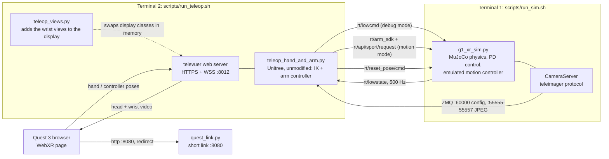
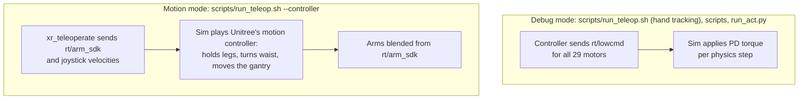
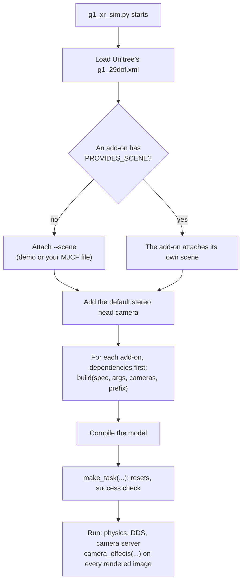
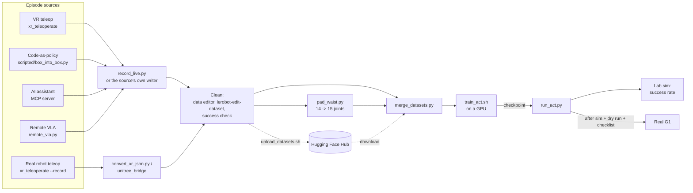

# Architecture

Which program talks to which, on which channel. Words in **bold** on first use are in the [glossary](GLOSSARY.md). Back to the [main README](../README.md).

The one design rule: **the simulator must look like the real G1 on the wire.** Everything else (teleop, recorders, policies) then runs unchanged against the sim or the robot.

## 1. Processes, ports and topics



DDS runs on domain 1, interface `lo` (this PC only). The real robot uses domain 0 on its own network, so sim and robot cannot be confused.

- Inside `g1_xr_sim.py`, physics runs on its own thread at real time and the main thread renders the cameras.

### DDS topics

| Topic | Direction (seen from the sim) | Content |
|---|---|---|
| `rt/lowstate` | publish, 500 Hz | Position, velocity, torque of the 29 motors + IMU |
| `rt/lowcmd` | subscribe | Target, gains and feed-forward torque for every motor (debug mode) |
| `rt/arm_sdk` | subscribe | Arm targets plus a blend weight (motion mode) |
| `rt/api/sport/request` | subscribe | Locomotion requests: walking velocity from the joysticks, damp |
| `rt/reset_pose/cmd` | subscribe | "Reset the objects" |
| `rt/sim_state` | publish, 30 Hz | JSON: object poses, base mode, `rtf` (real-time factor), `success` (sim only) |
| `rt/rewards_state` | publish, 30 Hz | JSON `{"rewards": [0 or 1]}`: the success flag, in the format of Unitree's Isaac simulation (sim only, scenes with a task) |

### Network ports

| Port | Protocol | Who listens | Used by |
|---|---|---|---|
| 8080 | HTTP | `scripts/quest_link.py` | The Quest: short link that redirects to :8012 |
| 8012 | HTTPS + WSS | xr_teleoperate (televuer) | The Quest: web page, poses, video |
| 60000 | ZMQ request/reply | the sim | Camera config ("which cameras exist") |
| 55555 | ZMQ publish | the sim | `head_camera` JPEG stream |
| 55556 | ZMQ publish | the sim | `left_wrist_camera` JPEG stream |
| 55557 | ZMQ publish | the sim | `right_wrist_camera` JPEG stream |

Only 8080 and 8012 must be open in the firewall. The others stay on this PC.

## 2. Two ways the robot is driven



- If `rt/lowcmd` arrived in the last 0.5 s it wins. Otherwise the sim is in motion mode. With no commands at all the sim holds the pose.
- The sim prints which one is active: `[sim] driven by rt/lowcmd ...`, `[sim] driven by rt/arm_sdk + joysticks ...` or `[sim] no commands - sim holds the robot`.
- Run **one** controller at a time. Two programs publishing `rt/lowcmd` fight each other.

## 3. The add-on mechanism

The simulator file never changes. Robot hardware and scenes are added by modules loaded at start.



| Add-on | Loaded by | Adds |
|---|---|---|
| [wrist_cameras](../02_wrist_cameras/wrist_cameras.py) | `--addon wrist_cameras` | 5010 wrists, gloves, brackets, D405 meshes, two wrist cameras |
| [lab_scene](../03_real2sim/lab_scene.py) | `--scene lab` or `--addon lab_scene` | The lab desk and room, mono head camera, task with success check, randomization, camera effects. Requires `wrist_cameras`. |

What a module may define (all optional):

| Name | Purpose |
|---|---|
| `REQUIRES = [...]` | Other add-ons to load first |
| `PROVIDES_SCENE = True` | It attaches its own environment instead of `--scene` |
| `add_args(parser)` | Extra command-line options |
| `build(spec, args, cameras, prefix)` | Edit the model before it is compiled; return the map `{teleimager topic: [camera names]}` |
| `make_task(model, prefix, args)` | Return an object with `reset_objects`, `object_poses`, `success`, `arm_home` |
| `camera_effects(rgb, camera_name)` | Post-process a rendered image (exposure, blur, noise) |
| `VIEWER_GEOM_GROUPS`, `DEBUG_VIEW` | Viewer-only settings |

The module must be importable: put it in one of the stage folders, which `scripts/env.sh` adds to `PYTHONPATH`.

## 4. The teleop display launcher

[teleop_views.py](../02_wrist_cameras/teleop_views.py) keeps xr_teleoperate unmodified:

1. It replaces two classes in memory (televuer's display class and teleimager's image client) with subclasses.
2. It then runs Unitree's `teleop_hand_and_arm.py` with the same arguments and working folder as a plain run.
3. The subclass draws the wrist images next to the head image and handles the layout switch.

The head image used for recording is never written to. If the sim offers no wrist stream, nothing is changed.

## 5. Data flow: from episodes to a deployed policy



All sources and `run_act.py` reach the robot through the same class, `G1Arms` ([robot_io.py](../04_recording/g1lab/robot_io.py)): `G1Arms("sim")` or `G1Arms("real")`.

## 6. Sim versus real robot

| | Sim | Real G1 |
|---|---|---|
| DDS domain | 1 | 0 |
| DDS interface | `lo` | the network card connected to the robot |
| Image server | this PC, 127.0.0.1 | the robot's PC2, 192.168.123.164 |
| `rt/sim_state`, `rt/rewards_state`, reset | yes | no |
| Balance | none (FIXED base) | Unitree's motion controller, or the gantry |
| Selected with | `--target sim` (default) | `--target real` |

## 7. Several sims side by side

Give each sim its own DDS domain and its own image ports:

```bash
scripts/run_sim.sh --scene lab --no-viewer --domain 3 --port-offset 1000
```

Clients then use `--domain 3 --image-port 61000` (60000 + offset). Keep the offset small enough that all ports stay below 65536.

## 8. Python environments

| Env | Made by | Used for | Main contents |
|---|---|---|---|
| `g1sim` | `install/install.sh` | Stages 1-3: sim and teleop | MuJoCo, pinocchio, xr_teleoperate's packages, unitree_sdk2py |
| `g1lab` | `install/setup_g1lab_env.sh` | Stages 4-5: recording, training, rollouts | LeRobot 0.4.1, CPU PyTorch, MuJoCo, pinocchio, mcp |
| `unitree_lerobot` (optional) | you, from Unitree's README | Unitree's data editor and converter | unitree_lerobot, PyQt5 |

`source scripts/env.sh <env>` activates an env, removes ROS 2 variables from the terminal and sets `PYTHONPATH` to the stage folders. Other env names: `G1_ENV` (sim/teleop scripts), `G1LAB_ENV` (VLA and training scripts), `G1_MCP_ENV` (MCP server), `G1_THIRD_PARTY` (location of the upstream clones).
